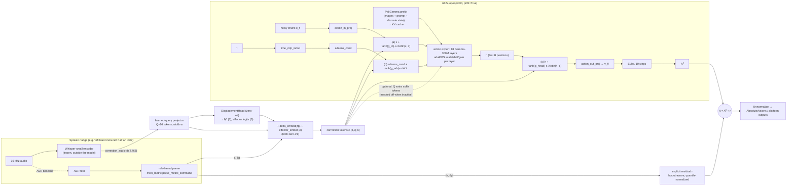

# MECI on π0.5 (openpi): spoken metric corrections in the flow-matching action expert

**Paper:** *Add Mid-Execution Corrections Interface to π0.5, as Fine-Tuning Data for VLA Policies* (Jessica Wu, University of Florida). This is the second-backbone version of MECI. The OpenVLA-OFT module is in `../audio_correction/`.

**Status:** design plus patch code. Nothing has been trained or evaluated, and no results are claimed. The code is unit-tested on CPU with dummy tensors on a reduced-size π0.5 (openpi's `dummy` Gemma and a Ti/16 SigLIP); see §8.

**Upstream:** [github.com/Physical-Intelligence/openpi](https://github.com/Physical-Intelligence/openpi), pinned to commit **`215abfb217dbac7d5f1273282331b9b1866c0479`** (2026-08-24 09:27 PT, "docs(droid): fix config search instruction (#1023)"). Source was read only through `raw.githubusercontent.com` and the GitHub API, file by file, with no clone. Every path, class, function, and line number below was checked at that commit.

---

## 1. Goal

A person says a **metric end-effector nudge** while π0.5 runs, and the nudge may name the effector: "left hand more left half an inch", "right gripper up 1 cm", "move forward 1 inch", "rotate gripper 10 degrees". The phrase is parsed (or predicted from audio) into an effector `e ∈ {default, left, right}` and a 6-D displacement `δp = [dx, dy, dz, droll, dpitch, dyaw]` in metres and radians in the declared frame (robot base). MECI then:

1. Conditions π0.5's **action expert** on correction tokens built from frozen Whisper-small features. Every path is behind a zero-initialized gate, so the patched model is bit-identical to the pretrained checkpoint at init and whenever no correction is active.
2. Adds an **explicit residual** over the action chunk, in openpi's normalized action space, so the commanded motion of the *named effector* adds up to `δp`. The residual respects each platform's action layout.
3. Trains with π0.5's own flow-matching loss on corrected chunks, plus an auxiliary `δp` and effector loss. The RL analogues are AWR-weighted flow matching and a Diffusion-DPO-style preference loss. On-policy exact-likelihood RL is left to πRL (Flow-Noise / Flow-SDE).

## 2. Verified openpi hook points (commit `215abfb`)

| What | File : line | Verified content |
|---|---|---|
| π0 / π0.5 model class | `src/openpi/models/pi0.py:66` | `class Pi0(_model.BaseModel)`; π0.5 = `Pi0Config(pi05=True)` (`pi0_config.py:31`). The comment at `pi0_config.py:28-30` says π0.5 (a) puts the state in the discrete language tokens and (b) injects the flow-matching timestep into the action expert with **adaRMSNorm**. |
| Two-expert Gemma with adaRMS | `pi0.py:73-80` | `_gemma.Module(configs=[paligemma_config, action_expert_config], adarms=config.pi05)`, `use_adarms=[False, True]` (adaRMS on the action expert only). |
| Action expert size | `models/gemma.py:69-78` | `gemma_300m`: width 1024, depth 18, 8 heads, 1 KV head, head_dim 256. Test-only `dummy`: width 64, depth 4 (`gemma.py:60-68`). |
| adaRMS | `gemma.py:113-131` | `RMSNorm(x, cond)`: `modulation = nn.Dense(3*d, kernel_init=zeros)(cond)` → `scale, shift, gate` (per sample, broadcast over tokens). Residuals use `x + y*gate` (`_gated_residual`, `gemma.py:453-459`). |
| Action in/out projections, time MLP | `pi0.py:92-100` | `action_in_proj: action_dim→width`, `time_mlp_in/out` (pi05), `action_out_proj: width→action_dim`. |
| **Suffix embedding** (action-expert input) | `pi0.py:140-186` | `embed_suffix(obs, noisy_actions, timestep)`. In the pi05 branch (`:162-169`), `time_emb` goes through `time_mlp_in → swish → time_mlp_out → swish`, then `action_expert_tokens = action_tokens` and **`adarms_cond = time_emb`**. Action tokens get `ar_mask = [True] + [False]*(H-1)` (`:182`). ← **MECI paths (a) and (b) and the optional suffix tokens** |
| Attention mask rule | `pi0.py:19-44` | `make_attn_mask(input_mask, mask_ar)`: a token attends to valid tokens whose `cumsum(mask_ar)` ≤ its own, AND-ed with `input_mask` on both sides. |
| **Flow-matching loss** | `pi0.py:189-214` | `compute_loss`: `time ~ Beta(1.5,1)*0.999+0.001` (`:197`), `x_t = t·noise + (1-t)·actions` (`:199`), `u_t = noise - actions` (`:200`), `positions = cumsum(input_mask)-1` (`:208`), `v_t = self.action_out_proj(suffix_out[:, -H:])` (`:212`), returns `mean((v_t-u_t)^2, -1)` of shape `(b, H)` (`:214`). ← **MECI path (c) (pre-head) + aux loss + residual-consistent target** |
| **Sampling** | `pi0.py:217-279` | `sample_actions(rng, obs, num_steps=10, noise=None)`: prefix KV cache (`:237`), Euler `step` (`:239-271`) with `positions = sum(prefix_mask) + cumsum(suffix_mask) - 1` (`:259`) and `v_t = action_out_proj(suffix_out[:, -H:])` (`:269`), `jax.lax.while_loop` from t=1 to 0 (`:278`). ← **MECI path (c) + explicit residual** |
| Observation / data format | `models/model.py:83-136, 144-208` | `Observation` (flax `struct.dataclass`) with `from_dict` (`:110`). `preprocess_observation` rebuilds an `Observation` (`:200`), so new fields must be forwarded there. |
| PyTorch port | `models_pytorch/pi0_pytorch.py:84-462` | `PI0Pytorch`: `embed_suffix(state, noisy_actions, timestep)` (`:238`, pi05 branch `:288-298`, `adarms_cond = time_emb` `:298`), `forward` (`:317-374`, returns `F.mse_loss(u_t, v_t, reduction="none")` `:374`), `sample_actions` (`:377-420`), `denoise_step` (`:422-462`, `return self.action_out_proj(suffix_out)` `:462`). PyTorch adaRMS lives in `transformers_replace/models/gemma/modeling_gemma.py` (`GemmaRMSNorm.dense`, zero-initialized). |
| Normalization (π0.5 = quantile) | `training/config.py:187`; `transforms.py:137-145, 170-181` | `use_quantile_norm = model_config.model_type != ModelType.PI0`. Quantile: `x_n = (x-q01)/(q99-q01+1e-6)*2-1`; `Unnormalize` passes through dims beyond `len(q01)`. z-score (π0 only): `(x-mean)/(std+1e-6)`. |
| Policy transform order | `policies/policy_config.py:77-89` | inputs: repack → data transforms → `Normalize` → model transforms; outputs: model → `Unnormalize` → data transforms (e.g. `AbsoluteActions`, `AlohaOutputs`). `Group.push` prepends outputs (`transforms.py:49-59`). |
| Policy → model | `policies/policy.py:90-94` | `Observation.from_dict(inputs)` then `self._sample_actions(rng, observation, **sample_kwargs)`. |
| ALOHA layout | `policies/aloha_policy.py:160-161, 91-101, 104-106, 190-202`; `training/config.py:229-279` | state/actions `[left 6 joints, left gripper, right 6 joints, right gripper]` (14-D); `AlohaOutputs` returns `[:, :14]`; `_joint_flip_mask() = [1,-1,-1,1,1,1,1,1,-1,-1,1,1,1,1]` (adapt_to_pi); `DeltaActions(make_bool_mask(6,-1,6,-1))` (`config.py:264`), so joints are **relative to the chunk-start state** and grippers are absolute. `pi05_aloha` = `Pi0Config(pi05=True)` (H=50) (`config.py:573`). `examples/aloha_real/main.py:18` executes 25 steps per chunk at `max_hz=50` (`:41`). |
| LIBERO layout | `policies/libero_policy.py:87-100`; `training/config.py:744-763` | `LiberoOutputs` returns `[..., :7]` = EE `[dpos(3), drot(3), gripper]`. `pi05_libero` = `Pi0Config(pi05=True, action_horizon=10, discrete_state_input=False)`, `extra_delta_transform=False` (LIBERO actions are already per-step deltas). `examples/libero/main.py:29` `replan_steps=5` (executes 5 of 10 actions per query). |
| LIBERO controller scale | LIBERO `libero/libero/envs/env_wrapper.py:17` (commit `8f1084e`): `controller="OSC_POSE"`; robosuite `v1.4.1` (openpi's `examples/libero/requirements.txt`) and `v1.4.0` (LIBERO's requirements) `controllers/config/osc_pose.json:5` | `output_max = [0.05, 0.05, 0.05, 0.5, 0.5, 0.5]` and `control_delta: true`. One unit of action commands a 5 cm / 0.5 rad set-point delta. |
| DROID layout | `policies/droid_policy.py:78-81`; `training/config.py:630-631, 403-408` | 8-D `[7 joints, gripper]`. `pi05_droid` (H=15) has no `DeltaActions`; `examples/droid/main.py:80` uses `RobotEnv(action_space="joint_velocity")` at `DROID_CONTROL_FREQUENCY = 15` (`:23`). The fine-tune configs use `JOINT_POSITION` + `DeltaActions(make_bool_mask(7,-1))`. |
| Checkpoint loading | `training/weight_loaders.py:38-54` | `CheckpointWeightLoader.load` merges missing params only for `missing_regex=".*lora.*"`, and `scripts/train.py:73-76` then checks the full pytree. New modules must be added to the regex. |

## 3. Architecture



## 4. Design details

### 4.1 Inputs carried as optional `Observation` fields

The patch adds seven optional fields to `openpi.models.model.Observation` (all `None` by default, so existing pipelines are unaffected), plus `CORRECTION_KEYS`. They are read in `from_dict`, forwarded by `preprocess_observation`, and passed through `AlohaInputs`, `LiberoInputs`, and `DroidInputs`:

| Field | Shape | Meaning |
|---|---|---|
| `correction_audio` | `(b, T_a, 768)` | frozen Whisper-small encoder features of the utterance, computed outside the model (policy server or cached for training) |
| `correction_audio_mask` | `(b, T_a)` | valid frames |
| `correction_active` | `(b,)` bool | correction in its hold/fade window at this query |
| `correction_strength` | `(b,)` | hold-and-fade strength `s_t ∈ [0,1]` (default hold 16, fade 8, as in the OFT module) |
| `correction_delta` | `(b, 6)` | parsed or teacher `δp` (m, rad). It conditions the tokens when given (`use_given_delta`) and is the aux-loss target |
| `correction_effector` | `(b,)` int | 0 default, 1 left, 2 right |
| `correction_residual` | `(b, H, 32)` | explicit residual in **normalized** model action space (from `meci_metric.build_correction_inputs`) |

Whisper stays outside the JAX graph on purpose. It is frozen, openpi has no JAX Whisper, and moving it out keeps the jitted `sample_actions` unchanged in structure.

### 4.2 Fusion paths (all zero-init gated)

`MECICorrection` (`src/openpi/models/meci_correction.py`, Flax NNX; `MECICorrectionTorch` mirrors it):

- **Projector:** `Q=16` learned queries cross-attend to LayerNorm(Whisper features), followed by an MLP, giving `c ∈ R^{Q×w}` with `w = 1024` for `gemma_300m`.
- **DisplacementHead:** mean-pool, Linear, swish, then a zero-init Linear to `[δp̂ (6, scaled by 5 cm / 0.5 rad), effector logits (3)]`.
- **Conditioners:** zero-init `delta_embed(δp/scale)` and `effector_embed(e)` are added to every token. Without a parsed command, the predicted `δp̂` (stop-grad) and softmax effector mix are used instead.
- **(a) input path:** `x ← x + tanh(g_in)·s·XAttn(x, c)` on the action-expert input tokens, before all 18 layers.
- **(b) adaRMS path:** `adarms_cond ← adarms_cond + tanh(g_ada)·s·W_ada c̄`. This uses π0.5's own layer-wide conditioning channel and reaches every expert layer's scale/shift/gate. It is per-sample, not per-token.
- **(c) pre-head path:** `h ← h + tanh(g_head)·s·XAttn(h, c)` on the last-H hidden states right before `action_out_proj`. This is the analogue of the OpenVLA-OFT fusion point.
- **Optional `suffix_tokens` mode:** the `Q` tokens are prepended to the suffix with `ar_mask=[True]+[False]*(Q-1)`, so action tokens attend to them and they do not attend to actions. `input_mask = correction_active`, so when inactive, `make_attn_mask` removes them and `cumsum(input_mask)` leaves the action positions unchanged (identity). This mode is **not** an identity at init while active.

**Identity argument:** `g_* = 0` at init, so `tanh(g)=0` and every path adds exactly 0. With `s=0` (inactive), every path adds exactly 0 even after training, and the explicit residual is masked by `correction_active` as well. Gradients still reach the gates, as in the Flamingo-style gated cross-attention, because `∂/∂g = s·XAttn(·) ≠ 0`.

### 4.3 Explicit residual: layout-aware and effector-routed (`src/openpi/shared/meci_metric.py`)

1. `δp` comes from the phrase: SI conversion (inch 0.0254 m, cm, mm, m, degrees→rad), with the axis and sign from `DIRECTION_AXES` (placeholders until calibrated).
2. **Raw action delta** `Δa` for the named effector:
   - **LIBERO (Cartesian, per-step):** `Δa[0:6] = δp / [0.05,0.05,0.05,0.5,0.5,0.5]` (OSC_POSE `output_max`).
   - **ALOHA (joint, chunk-relative):** `Δq = Jᵉᵀ(JᵉJᵉᵀ+λ²I)⁻¹ δp` (damped least squares, first order) with the **named arm's** 6×6 Jacobian at the current state. It is written only into that arm's slice (`left 0:6`, `right 7:13`); grippers (6, 13) are untouched. It is then multiplied by `_joint_flip_mask` into openpi's "pi" joint space. **An unnamed correction on ALOHA is not routed** (`routed=False`, residual 0) and is left to the learned path. openpi ships no arm kinematics, so the caller supplies `jacobian_fn(effector)`, e.g. from the ViperX-300s URDF.
   - **DROID:** joint space (7 joints + gripper). Use `DROID_JOINT_POSITION` (chunk-relative, fine-tune configs) or `DROID_JOINT_VELOCITY` (per-step / dt; `velocity_dt` must be set explicitly, see open decisions).
   - Single-arm platforms ignore the effector name.
3. **Distribution over the hold window** (strengths `w_t`, shares `w_t/Σw`, indexed by control steps since the utterance, so replanning every 5 steps on LIBERO or 25 on ALOHA is handled by passing `chunk_start = steps elapsed`):
   - per-step: `r_t = share_t · Δa`, so Σ over the window = `Δa`;
   - chunk-relative: `r_t = cumsum(share)_t · Δa` (a ramp re-based on each new chunk's state), so the final values over consecutive chunks add up to `Δa`.
4. **Normalization** (π0.5 quantile): `r_n = 2·r / (q99−q01+1e-6)` on the stats dims (exact, because openpi's maps are per-dim affine); padded dims (up to 32) pass through.
5. The model adds `r_n` to the sampled chunk (`x_0 + r_n`, active samples only). During training, the flow target is `a_exec − r_n`, so sampling plus the residual reproduces the executed chunk. `MECIConfig.explicit_residual=False` turns this off (learned path only).

### 4.4 Training

- **Follow pass** (during-correction chunks, correction fields attached): openpi's flow-matching loss `‖v_θ − u_t‖²` on `(a_exec − r_n)` + `aux_weight · (L1(δp̂/scale, δp/scale) + CE(effector))`. The aux term is added per sample to `compute_loss`'s `(b, H)` output, so `scripts/train.py:150`'s `jnp.mean` needs no change.
- **Autonomous pass** (correction fields absent, so the model is exactly π0.5): there is no tractable log-likelihood for flow matching, so the OFT Laplace reading does not apply.
  - **AWR-weighted flow matching** (`meci_correction.awr_weights`): multiply the per-sample flow-matching loss by `min(exp(Â/β), w_max)`.
  - **Diffusion-DPO-style** (`meci_correction.flow_dpo_loss`, Wallace et al. 2024): `−log σ(−β[(ℓθ(a⁺)−ℓref(a⁺)) − (ℓθ(a⁻)−ℓref(a⁻))])` with shared noise and time between policy and frozen reference. `a⁺` is the during-correction chunk and `a⁻` is the pre-correction chunk from the same state.
  - **πRL (arXiv:2510.25889)** is the path to *on-policy* RL with tractable likelihoods: Flow-Noise (denoising as a discrete-time MDP with a learnable noise network, giving exact log-likelihoods) or Flow-SDE (ODE→SDE conversion inside a two-layer MDP). Correction-derived rewards could drive such an update. This is noted as future work; nothing here is implemented or claimed.
- **Parameters / freezing:** the adapter has **18.4 M** parameters at `w=1024, d_audio=768, Q=16` (counted from the module). The patch adds `.*meci_correction.*` to `CheckpointWeightLoader`'s missing-param regex so a released π0.5 checkpoint loads and the adapter starts from its zero-init. A first audio-only stage can freeze everything else via `TrainConfig.freeze_filter` (e.g. `nnx.Not(nnx_utils.PathRegex(".*meci_correction.*"))`); this is not in the patch.

### 4.5 Inference loop (policy side)

When an utterance ends: run Whisper, then `build_correction_inputs(phrase, layout, action_horizon=H, chunk_start=0, norm_stats_actions=norm_stats["actions"], jacobian_fn=...)`, add the audio fields, **flush the open-loop action queue** (`examples/libero/main.py` `action_plan` deque; `ActionChunkBroker` on ALOHA), and re-query. Re-query with `chunk_start = steps elapsed` while `s_t > 0`.

## 5. Files

```
audio_correction_pi05/
  DESIGN.md                      this file
  README.md                      how to apply and test
  meci_pi05/meci_metric.py       NumPy: parser, units, layouts, DLS IK, residual, quantile mapping  (→ src/openpi/shared/)
  meci_pi05/meci_correction.py   Flax NNX adapter + AWR / flow-DPO helpers                          (→ src/openpi/models/)
  meci_pi05/meci_correction_pytorch.py  PyTorch mirror for PI0Pytorch                              (→ src/openpi/models_pytorch/)
  patches/openpi-pi05-meci.diff  unified diff vs openpi@215abfb (apply with `patch -p1` at repo root)
  tests/                         tiny_setup.py, reference_pristine.py, test_meci_pi05.py, run_tests.sh, test_output.txt
  paper_section_pi05.tex         LaTeX subsection (not inserted into main.tex)
  refs_additions_pi05.bib        new, verified BibTeX entries
```

The diff touches `models/pi0.py`, `models/pi0_config.py` (`meci: MECIConfig | None = None`), `models/model.py`, `models_pytorch/pi0_pytorch.py`, `policies/{aloha,libero,droid}_policy.py`, and `training/weight_loaders.py`, and adds the three `meci_*` files. With `meci=None` (the default) the model is the unchanged openpi model.

## 6. Why this hook (vs. alternatives)

- **adaRMS only** is the most "native" π0.5 hook, but it is per-sample (one vector for all H steps and both arms), so it cannot express *which* chunk steps or arm should move. It is kept as path (b) and complemented by token-level cross-attention.
- **Extra suffix tokens only** let all 18 layers attend to the correction, but they break init-identity while active. They are kept as an ablation (`mode="suffix_tokens"` / `"gated+suffix_tokens"`).
- **Prefix tokens** (adding the audio to the PaliGemma prefix) would change the KV cache and the 2B backbone, and would cost a prefix recompute per utterance. Not chosen.
- **Explicit residual:** a sampler cannot be relied on to hit a metric target exactly, so the commanded motion is enforced in action space, while the learned path handles everything else (contact, Jacobian error, frame confusion).

## 7. Relationship to the OpenVLA-OFT module

The parser grammar, units, effector aliases, hold/fade (16/8), the zero-init displacement head and conditioners, and the ASR+parser baseline all match `../audio_correction/`. The differences: the fusion target is the flow-matching action expert, not an L1 head; there are three gated paths instead of one; normalization is π0.5 quantile instead of OFT BOUNDS_Q99 (the formula is the same, but π0.5 uses `1e-6` and no clip); the residual is layout-aware (joint space and chunk-relative on ALOHA/DROID); and RL uses likelihood-free analogues.

## 8. Tests (CPU, JAX 0.5.3 / Flax 0.10.2 / torch 2.7.1+cpu, Python 3.11 venv)

`tests/run_tests.sh` first runs **unpatched** openpi (`reference_pristine.py`) and saves reference outputs, then runs `test_meci_pi05.py` against the **patched** tree (JAX and PyTorch groups in separate processes to limit RAM). The tiny model is π0.5 with openpi's `dummy` Gemma (width 64), H=10, and SigLIP Ti/16 (a test-only shim, since `pi0.py:84` hard-codes So400m/14). Two test-only fixes are needed to make the comparisons meaningful:

- openpi zero-initializes the adaRMS Dense (`gemma.py:128`), so in a *fresh* model every expert residual gate is 0 and the expert ignores attention. Both reference and patched runs therefore set those kernels to the same random values (`randomize_adarms_*`), emulating pretrained weights.
- `gemma_pytorch.py` hard-codes `projection_dim = 2048`, so for the PyTorch dummy the SigLIP projector is replaced by a deterministic 64-wide one in both runs.

Results: **32 passed** (29 JAX/metric + 3 PyTorch); see `tests/test_output.txt`. They cover:

- **Parser** (7 phrases incl. "left hand more left half an inch", "right gripper up 1 cm", "Left arm, back two centimeters", "rotate gripper 10 degrees"; 4 non-metric rejections).
- **Residual = δp:** LIBERO per-step residual across two 10-step chunks, passed through openpi's own `transforms.Unnormalize(use_quantiles=True)` and the OSC scale, sums to δp (1.27 cm) to 1e-6. On ALOHA the ramp ends at Δq; split windows add up to Δq; `J·Δq = δp`.
- **Effector routing:** the left/right slices only, grippers untouched, an unnamed ALOHA correction is not routed, and a single-arm platform ignores the name.
- **Identity (JAX and PyTorch):** the patched model with no correction is **bit-identical** to unpatched openpi (loss and `sample_actions`). With an active correction at zero-init gates, it is also bit-identical. With an inactive correction and trained (non-zero) gates and heads, it is still bit-identical. In a mixed batch, only the active sample changes. Each of the three paths changes the output when its gate opens.
- **Suffix-token mode:** identical when inactive, and changes the output when active.
- **Residual:** `sample_actions` returns baseline + residual (≤1e-6).
- **Training:** finite loss, non-zero gradients on all three gates and on the displacement head (JAX `nnx.value_and_grad`, torch `backward`); the aux loss is 0 for inactive samples.
- **Data path:** `Observation.from_dict`, `preprocess_observation`, and `LiberoInputs` / `AlohaInputs` carry the correction keys.
- **Checkpoint loading:** the loader merges the missing `meci_correction` params.
- **RL helpers:** AWR clipping, and flow-DPO = log 2 at zero margin, lower when the preferred chunk improves.

Patch check: `patch -p1 --dry-run` and then `patch -p1` apply cleanly to fresh raw copies of the 8 upstream files at `215abfb`. All touched files `py_compile`, and the patched files match the tested tree byte for byte. `ruff check` with openpi's config reports only the 4 findings that already exist upstream.

## 9. Open decisions

1. **Primary fusion path:** gated (a+b+c, default), suffix tokens, or both. Needs an ablation once trained. Whether (b) alone (adaRMS, cheapest) is enough is also open.
2. **Residual on or off:** `explicit_residual=True` enforces δp in action space. On ALOHA and DROID it depends on Jacobian quality (DLS is first order and assumes small nudges). The weight `aux_weight` (default 0.1) still needs to be chosen.
3. **Arm kinematics:** openpi ships none. Choose the ViperX-300s (ALOHA) and Franka (DROID) Jacobian source, whether to apply the `adapt_to_pi` flip before or after the Jacobian, and the frame (base versus per-arm base for bimanual "left/right").
4. **Frame and sign calibration** (`DIRECTION_AXES` are placeholders). Also calibrate LIBERO's executed versus commanded OSC displacement: `output_max` is a set-point delta, not a guaranteed motion.
5. **DROID velocity units:** `pi05_droid` outputs joint velocities at 15 Hz. Whether these are rad/s or scaled was not verified, so `velocity_dt` is left unset on purpose.
6. **Unnamed corrections on bimanual robots:** currently not routed (residual 0; the learned path decides). Alternatives are asking back, or using the last-named arm.
7. **Whisper placement and latency:** out-of-graph Whisper-small (768) or whisper-base (512). Measure the end-of-speech → corrected-action latency.
8. **RL recipe for π0.5:** AWR-weighted flow matching versus flow-DPO (off-policy, implemented as loss helpers only) versus πRL Flow-Noise/Flow-SDE (on-policy, not implemented). Also how to pair pre- and during-correction chunks for DPO when they come from different states.
9. **State in the prompt:** π0.5 puts discrete state in the prefix (`discrete_state_input`, except `pi05_libero`). Corrections do not touch the prefix, which is fine, but a held correction does not alter the tokenized state.
10. **π\*0.6 / other checkpoints:** not openly released at this commit. Only `pi05_*` configs were verified.
